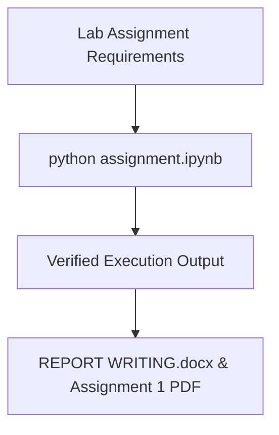

<p align="center">
  
</p>

<p align="center">
   
</p>


## 📌 Table of Contents
- [📖 Executive Summary](#-executive-summary)
- [✨ Key Features & Capabilities](#-key-features--capabilities)
- [🏗️ System Architecture & Workflow](#️-system-architecture--workflow)
- [🛠️ Tech Stack Breakdown](#️-tech-stack-breakdown)
- [⚙️ Reproducible Quickstart & Setup](#️-reproducible-quickstart--setup)
- [📂 Project Directory Layout](#-project-directory-layout)
- [👩‍💻 Author & Contributions](#-author--contributions)

---

## 📖 Executive Summary
### Problem Statement
Establishing software programming fundamentals requires practical lab assignments covering string processing, lists, loops, and structured functional decompositions.

### Motivation & Solution Overview
A documented Python laboratory assignment including verified code notebooks, lab reports, and exercises for BCA Semester IV coursework.

---

## ✨ Key Features & Capabilities
- **Data Manipulation:** Python list operations, dictionary lookups, and string parsing.
- **Lab Documentation:** Includes academic lab manual and execution report.

---

## 🏗️ System Architecture & Workflow


---

## 🛠️ Tech Stack Breakdown
| Category | Technologies |
|---|---|
| **Language** | Python 3.9+ |
| **Deliverables** | Jupyter Notebook, PDF Lab Report |

---

## ⚙️ Reproducible Quickstart & Setup
```bash
git clone https://github.com/Bhumikaravi/python-assignment-01.git
cd python-assignment-01
pip install jupyter
jupyter notebook "python assignment.ipynb"
```

---

## 📂 Project Directory Layout
```text
python-assignment-01/
├── Assignment 1(LAB).pdf
├── python assignment.ipynb
├── REPORT WRITING.docx
└── README.md
```

---

## 👩‍💻 Author & Contributions
Developed by **Bhumika Ravi** ([@Bhumikaravi](https://github.com/Bhumikaravi)), Bachelor of Computer Applications (BCA) at **Alliance University, Bengaluru**.

- 💻 **GitHub Profile:** [github.com/Bhumikaravi](https://github.com/Bhumikaravi)
- 🔗 **LinkedIn:** [linkedin.com/in/bhumika-ravi-b5a01b326](https://www.linkedin.com/in/bhumika-ravi-b5a01b326/)
- 📬 **Email Contact:** [bhumikaravi2006@gmail.com](mailto:bhumikaravi2006@gmail.com)

---

<p align="center">
  
</p>
